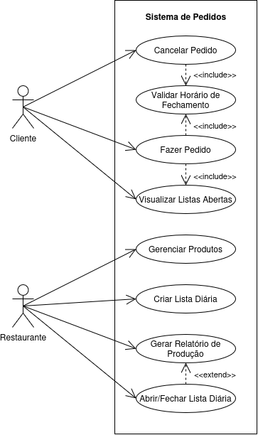
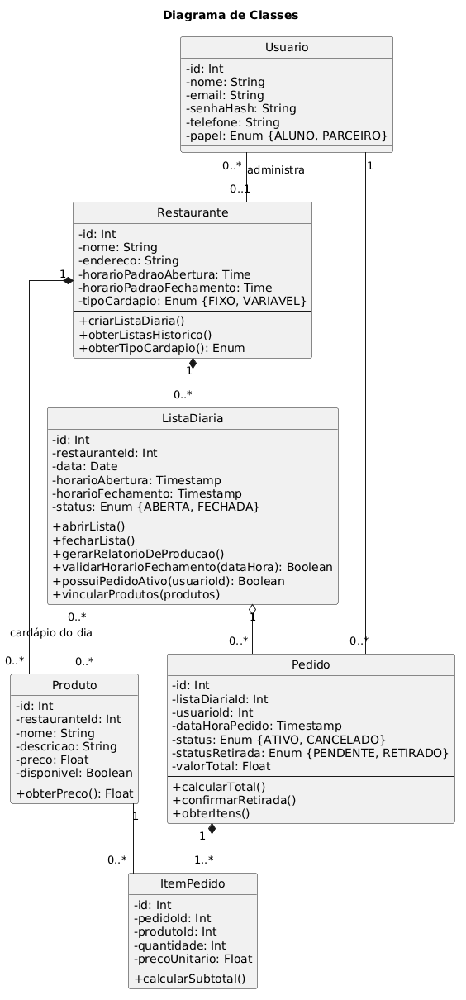
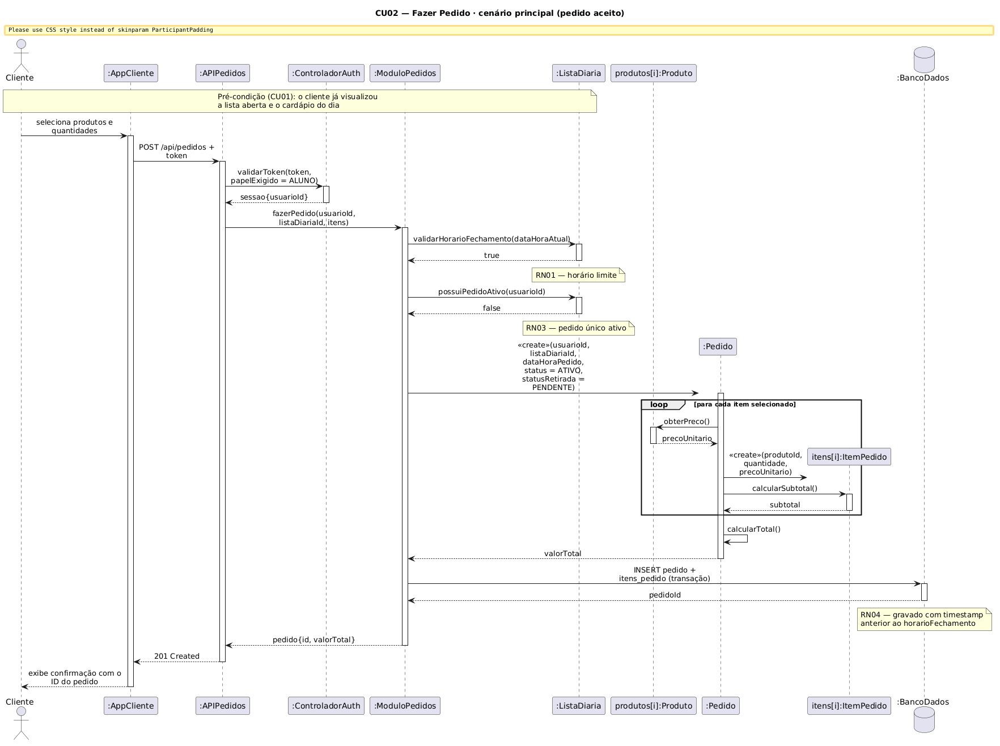
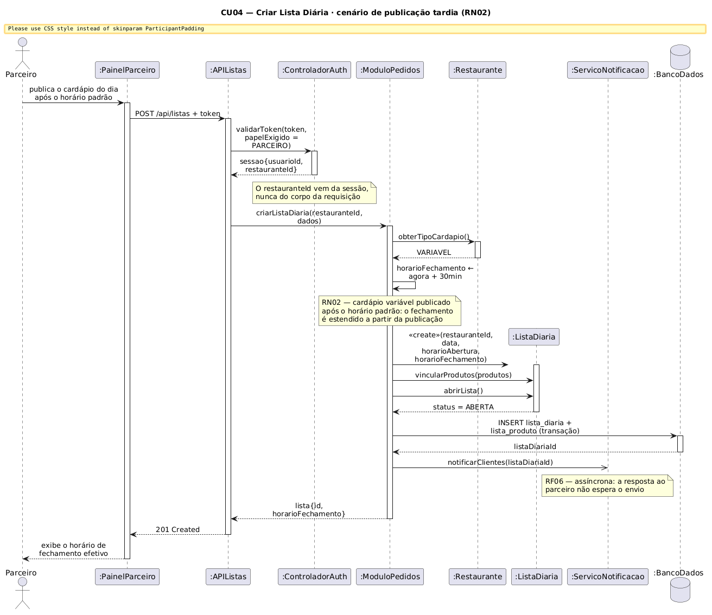
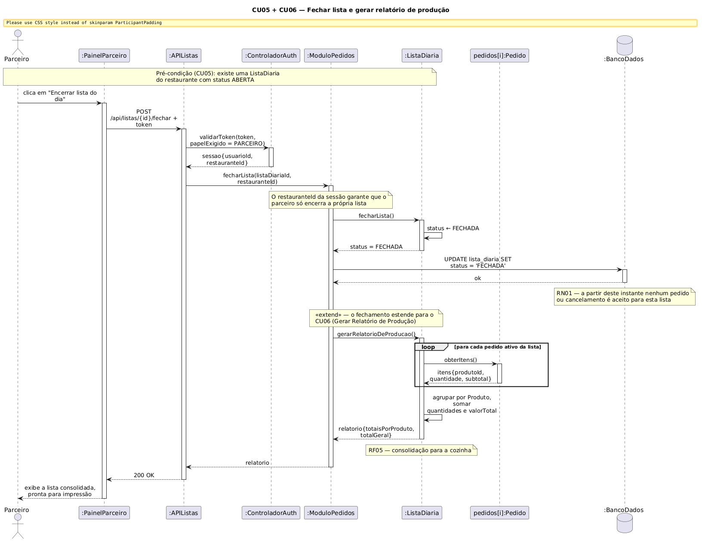
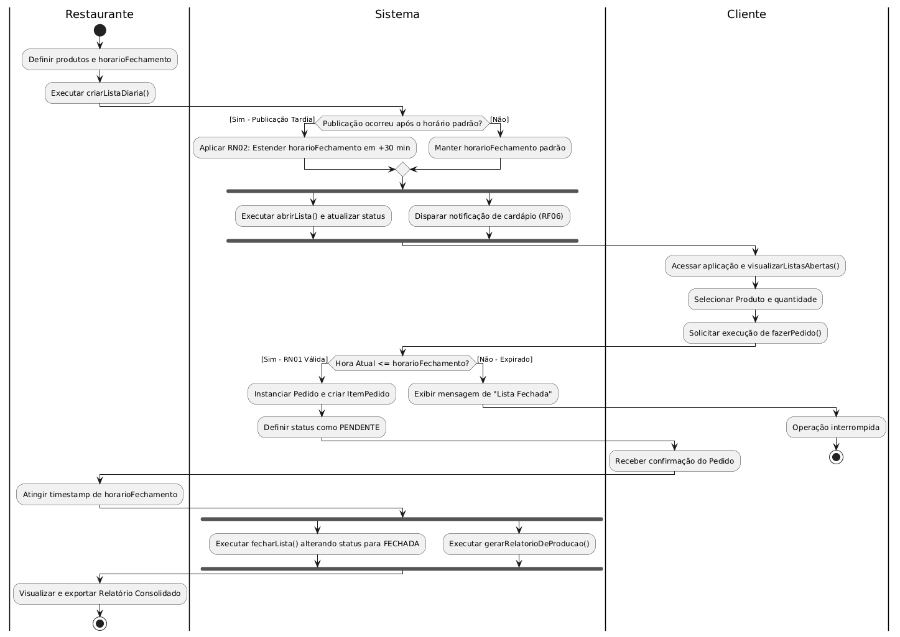
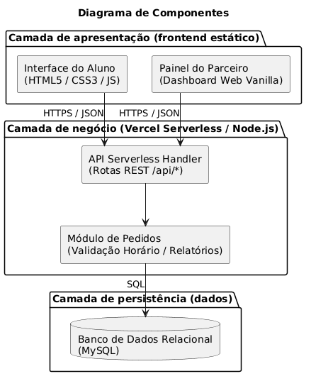

# Trivialists - Lista do Almoço de maneira trivial

*Erique Silva Gustavo Cardoso Paulo Oliveira* · Turma: 2024 - Ênfase em Ciência da Computação

# Visão geral do projeto

## Descrição do produto

O **Trivialists** é uma plataforma de centralização e gestão individualizada de pedidos de refeições diárias (quentinhas, tapiocas e lanches) para os estudantes do Impatech. A solução elimina a dependência do envio de mensagens de texto com listas compartilhadas em grupos do WhatsApp, automatizando a coleta dos pedidos, o controle de horários e a geração de relatórios de produção para os estabelecimentos parceiros.

## Objetivo e proposta de valor

**Objetivo**: A perda constante de pedidos de clientes por conta da sobrescrita acidental de listas no WhatsApp quando usuários utilizam versões desatualizadas da mensagem; a impossibilidade de alteração/cancelamento de pedidos quando os estabelecimentos postam os cardápios do dia após o tempo limite pré-estabelecido.

**Proposta de Valor**: Oferecer aos estudantes uma interface simples e individualizada para realizar, visualizar e cancelar pedidos com garantia de inclusão no sistema. Para os comércios parceiros, prover um painel centralizado que reduz o retrabalho, consolida as demandas em tempo real e notifica os clientes sobre a atualização do cardápio.

## Escopo

Dentro do Escopo:

- Cadastro e autenticação de Clientes (Estudantes) e Parceiros (Estabelecimentos).
- Modulo de publicação de cardápio fixo e variável diário.
- Realização e cancelamento individual de pedidos até o horário limite.
- Notificação/Alerta de publicação de cardápio do dia.
- Consolidação automática da lista de produção enviada ao restaurante.
- Suporte aos 3 parceiros iniciais (Salsalito, Pilograma e Barraquinha de Tapioca).

Fora do Escopo:

- Gestão de logística de entregas/motoboy fora do campus da faculdade.
- Processamento de pagamentos via Gateway/Cartão de Crédito em tempo real (o pagamento permanecerá via chave Pix informada pelo estabelecimento ou via pagamento presencial).
- Interface administrativa para cadastro de novos parceiros. Nesta versão, a inclusão de um estabelecimento é feita diretamente na base de dados pela equipe de desenvolvimento.

## Atores/stakeholders

**Cliente (Aluno/Servidor Impatech)**: Realiza pedidos, escolhe variações de pratos e visualiza status.

**Parceiro (Comerciante Local - Salsalito, Pilograma, Tapioca)**: Cadastra/atualiza o cardápio diário, define horários de corte e acessa o relatório de pedidos consolidados.

**Administrador do Sistema**: Responsável pela manutenção da plataforma e pelo cadastro dos estabelecimentos parceiros. É um *stakeholder* do projeto, mas não interage com o sistema por meio de interface própria nesta versão, motivo pelo qual não figura como ator no diagrama de casos de uso.

## Glossário

**Quentinha**: Refeição pronta servida em embalagem individual descartável.

**Cardápio Variável**: Pratos do dia cujo tipo de acompanhamento/proteína muda diariamente (ex: Salsalito).

**Cardápio Fixo**: Opções com disponibilidade contínua sem alteração diária (ex: Pilograma e Tapioca).

**Horário Limite (Cut-off Time)**: Horário máximo estipulado pelo restaurante para que os pedidos e cancelamentos do dia sejam aceitos.

**Lista Sobrescrita**: Evento no WhatsApp onde um usuário cola uma lista antiga por engano, apagando os nomes dos clientes que pediram na mensagem posterior.

# Requisitos e Regras de Negócio

## Regras de Negócio (RN)

- **RN01 - Respeito ao Horário Limite**: O sistema deve bloquear novos pedidos e cancelamentos para o dia após o horário limite definido pelo estabelecimento.
- **RN02 - Publicação Tardia do Cardápio Variável**: Caso o parceiro com cardápio variável não publique as opções do dia até o horário limite regular, o tempo limite de pedidos/cancelamentos daquele restaurante deve ser automaticamente estendido por 30 minutos após o momento da publicação.
- **RN03 - Pedido Único Ativo**: Um cliente pode ter apenas um pedido ativo por restaurante para a mesma data/refeição. Pedidos cancelados não contam para esta restrição, de modo que o cliente possa cancelar e refazer o pedido enquanto a lista estiver aberta.
- **RN04 - Confirmação do Pedido**: Um pedido é considerado válido após ser gravado no banco de dados com timestamp anterior ao horário limite.
- **RN05 - Escopo de Acesso**: Um cliente só pode consultar e cancelar os próprios pedidos. Um parceiro só pode publicar listas, encerrá-las e gerar relatórios do restaurante que administra. O vínculo entre usuário e restaurante é obtido da sessão autenticada, nunca de dados informados na requisição.

## Requisitos Funcionais (RF)

**RF01**: Visualizar Cardápio.\
**Descrição**: O sistema deve permitir que o cliente visualize os cardápios (fixo ou do dia) dos parceiros.\
**Prioridade**: Alta.\
\
**RF02**: Cadastrar Cardápio Diário.\
**Descrição**: O parceiro deve conseguir publicar o cardápio do dia informando opções de pratos, acompanhamentos e observações.\
**Prioridade**: Alta.\
\
**RF03**: Fazer Pedido.\
**Descrição**: O cliente deve poder registrar individualmente o seu pedido escolhendo o prato e a quantidade sem depender de mensagens coletivas.\
**Prioridade**: Alta.\
\
**RF04**: Cancelar Pedido.\
**Descrição**: O cliente deve conseguir cancelar seu pedido desde que respeitado o tempo limite estipulado.\
**Prioridade**: Alta.

**RF05**: Consolidar Pedidos.\
**Descrição**: O sistema deve gerar relatórios automáticos agrupando os totais de cada item por restaurante ao atingir o horário de corte.\
**Prioridade**: Alta.\
\
**RF06**: Notificar Atualização de Cardápio.\
**Descrição**: O sistema deve notificar os clientes cadastrados quando o restaurante parceiro atualizar o cardápio do dia.\
**Prioridade**: Média.\
\
**RF07**: Configurar Horário Limite.\
**Descrição**: O parceiro deve poder definir e alterar o horário limite para recebimento de pedidos.\
**Prioridade**: Média.\
\
**RF08**: Autenticar Usuário.\
**Descrição**: O sistema deve permitir o cadastro e a autenticação de clientes e parceiros, controlando o acesso às funcionalidades conforme o papel do usuário.\
**Prioridade**: Alta.

## Requisitos Não Funcionais (RNF)

**RNF01**: Desempenho.\
**Descrição**: O sistema deve processar a confirmação de pedido e atualizar o totalizador em tempo de resposta reduzido.\
**Métrica/Critério**: Responder em até 2.0s para 95%das requisições.\
\
**RNF02**: Usabilidade.\
**Descrição**: A interface deve ser otimizada para uso em telas de smartphones de diversos portes.\
**Métrica/Critério**: Padrão Mobile-First com 100%de responsividade.\
\
**RNF03**: Disponibilidade.\
**Descrição**: O sistema deve estar operacional nos horários de pico de solicitações (08:00 às 14:00).\
**Métrica/Critério**: Disponibilidade de 99.5%durante o horário comercial.\
\
**RNF04**: Segurança/LGPD.\
**Descrição**: Os dados pessoais dos alunos devem ser armazenados com proteção e privacidade.\
**Métrica/Critério**: Tráfego integralmente sob TLS (HTTPS); senhas armazenadas como *hash* com sal, por meio de algoritmo próprio para esse fim (bcrypt ou Argon2), de modo que não sejam recuperáveis nem pela equipe de desenvolvimento.

## Histórias de Usuário (Exemplos Principais)

**HU01**: Como aluno da Impatech, quero fazer meu pedido de quentinha individualmente pelo aplicativo, para que meu nome não seja apagado por erros de cópia no WhatsApp.\
**Critérios de Aceite**: O sistema deve registrar o nome e item de forma isolada; deve emitir um comprovante visual com o ID do pedido.\
\
**HU02**: Como dono do Salsalito, quero postar o cardápio do dia e definir o horário limite de pedidos, para que eu consiga organizar a produção na cozinha com antecedência.\
**Critérios de Aceite**: O sistema deve notificar os clientes e travar novos pedidos ao bater a hora limite estabelecida.

## Priorização e Núcleo do Produto

O núcleo mínimo capaz de entregar valor é o conjunto que substitui integralmente o fluxo hoje realizado por mensagens no WhatsApp: o parceiro publica o cardápio do dia, o aluno registra o pedido em seu próprio nome dentro do prazo, e o parceiro recebe a lista consolidada para a cozinha. Esse núcleo corresponde aos requisitos de prioridade Alta **RF01, RF02, RF03, RF04, RF05 e RF08** sustentados pelas regras **RN01, RN03, RN04 e RN05**.

Os demais itens são incrementos sobre um produto já utilizável. O **RF06** (notificação) melhora a experiência, mas na ausência dele o aluno ainda consegue abrir o aplicativo e verificar se a lista foi publicada. O **RF07** (configuração do horário limite pelo parceiro) pode ser substituído no primeiro ciclo por um horário fixo definido em cadastro, e a **RN02** só passa a ser necessária quando o parceiro de cardápio variável ganha autonomia para publicar fora do horário padrão.

## Matriz de Rastreabilidade

A Tabela [tab:rastreabilidade](#tab%3Arastreabilidade) liga cada requisito funcional e regra de negócio aos casos de uso que os realizam e às classes do domínio envolvidas.

l X X **Requisito** & **Caso(s) de uso** & **Classe(s) envolvidas**\
RF01 & CU01 & ListaDiaria, Produto\
RF02 & CU04, CU07 & ListaDiaria, Produto\
RF03 & CU02 & Pedido, ItemPedido, ListaDiaria, Produto\
RF04 & CU03 & Pedido, ListaDiaria\
RF05 & CU06 & ListaDiaria, Pedido, ItemPedido\
RF06 & CU04 & ListaDiaria\
RF07 & CU04, CU05 & Restaurante, ListaDiaria\
RF08 & CU08 & Usuario\
RN01 & CU01, CU02, CU03, CU05 & ListaDiaria\
RN02 & CU04 & Restaurante, ListaDiaria\
RN03 & CU02 & ListaDiaria, Pedido\
RN04 & CU02 & Pedido\
RN05 & CU02 a CU07 & Usuario, Restaurante*Rastreabilidade entre requisitos, casos de uso e classes do domínio.*

# Diagrama de Casos de Uso (UML)

A Figura [fig:casosdeuso](#fig%3Acasosdeuso) apresenta o diagrama de casos de uso do sistema de pedidos, com a fronteira do sistema, os dois atores e as relações de inclusão e extensão entre os casos de uso. Em seguida detalhamos os elementos relevantes de cada um.

 &#x20;

*Diagrama de casos de uso* 

**CU01**: Visualizar Listas Abertas.\
**Ator/Atores**: Cliente.\
**Requisitos Funcionais**: RF01 (Visualizar Cardápio).\
**Regras de Negócio**: RN01 (Respeito ao Horário Limite).\
**Pré-condições**: O cliente deve estar autenticado e com acesso à aplicação.\
**Pós-condições**: O sistema exibe os estabelecimentos e seus respectivos cardápios disponíveis para o dia.\
**Fluxo Principal**:

1. O Cliente acessa a tela principal do aplicativo.
2. O sistema realiza uma busca por todas as instâncias de ListaDiaria gravadas no banco cujo atributo status seja igual a ABERTA e cujo horarioFechamento ainda não tenha sido atingido.
3. O sistema exibe a relação de restaurantes parceiros (ex.: Salsalito, Pilograma e Tapioca) com os respectivos cardápios e seus horários limite de encerramento (horarioFechamento).

**Fluxos Alternativos**:

1. **FA01 (Filtro por Restaurante)**: O Cliente seleciona um restaurante específico para visualizar apenas seus itens de Produto cadastrados.

**Fluxos de Exceção**:

1. **FE01 (Nenhuma Lista Aberta)**: Caso não existam listas abertas no horário da consulta, o sistema exibe a mensagem: “Nenhum restaurante está recebendo pedidos no momento”.

**CU02**: Fazer Pedido.\
**Ator/Atores**: Cliente.\
**Requisitos Funcionais**: RF03 (Fazer Pedido).\
**Regras de Negócio**: RN01 (Horário Limite), RN03 (Pedido Único Ativo), RN04 (Confirmação do Pedido), RN05 (Escopo de Acesso).

**Pré-condições**: O cliente deve ter executado o CU01 (Visualizar Listas Abertas), selecionar um restaurante com ListaDiaria em status ABERTA e não ter outro pedido ativo para o mesmo restaurante no dia.\
**Pós-condições**: Um novo registro de Pedido e seus respectivos ItemPedido são gravados no banco de dados.

**Fluxo Principal**:

1. O Cliente seleciona um ou mais itens (Produto) do cardápio e especifica as quantidades.
2. O Cliente clica em “Confirmar Pedido”.
3. O sistema executa o caso de uso de validação interna (Validar Horário de Fechamento), verificando se a hora atual é menor ou igual ao horarioFechamento da ListaDiaria.
4. O sistema verifica a RN03 para garantir que não há outro pedido ativo do mesmo Cliente para aquela ListaDiaria.
5. O sistema instancia o objeto Pedido com status ATIVO e status de retirada PENDENTE, e calcula o valorTotal com base nos objetos ItemPedido. O preço unitário de cada item é copiado do Produto no momento da gravação, de modo que alterações posteriores no cardápio não alterem pedidos já registrados.
6. O sistema exibe a confirmação na tela do Cliente com o identificador (id) do pedido.

**Fluxos Alternativos**:

1. **FA01 (Alteração de Item Antes do Envio)**: O Cliente ajusta a quantidade de um ItemPedido no carrinho antes de acionar a confirmação final.

**Fluxos de Exceção**:

1. **FE01 (Horário de Fechamento Expirado)**: Se a validação indicar que a hora atual ultrapassou o horarioFechamento, o sistema bloqueia o registro, exibindo: “Não foi possível concluir. A lista deste restaurante acabou de ser encerrada”.
2. **FE02 (Pedido Duplicado - RN03)**: Se o Cliente já possuir um pedido ativo no restaurante para a data, o sistema impede a gravação e solicita que o Cliente cancele ou altere o pedido existente.

**CU03**: Cancelar Pedido.\
**Ator/Atores**: Cliente.\
**Requisitos Funcionais**: RF04 (Cancelar Pedido).\
**Regras de Negócio**: RN01 (Respeito ao Horário Limite), RN05 (Escopo de Acesso).\
**Pré-condições**: O Cliente deve estar autenticado e possuir um Pedido ativo vinculado a uma ListaDiaria com status ABERTA.\
**Pós-condições**: O status do Pedido passa a CANCELADO e o pedido deixa de ser contabilizado no relatório de produção da ListaDiaria, liberando o Cliente para registrar um novo pedido no mesmo restaurante enquanto a lista permanecer aberta.

**Fluxo Principal**:

1. O Cliente acessa a seção “Meus Pedidos”.
2. O Cliente seleciona o pedido desejado e clica no botão “Cancelar Pedido” (cancelarPedido()).
3. O sistema aciona o caso de uso Validar Horário de Fechamento.
4. Constatado que a lista ainda está dentro do prazo, o sistema atualiza o status do Pedido para CANCELADO.
5. O sistema exibe mensagem confirmando o cancelamento com sucesso.

**Fluxos Alternativos**: Não possui. **Fluxos de Exceção**:

1. **FE01 (Tentativa de Cancelamento Após o Fechamento)**: Se o horário limite já tiver expirado, o sistema bloqueia a ação e exibe: “Não é mais possível cancelar o pedido, pois a lista do restaurante já foi encerrada para a produção”.

**CU04**: Criar Lista Diária.\
**Ator/Atores**: Restaurante (Parceiro).\
**Requisitos Funcionais**: RF02 (Cadastrar Cardápio Diário), RF06 (Notificar Atualização de Cardápio) e RF07 (Configurar Horário Limite).\
**Regras de Negócio**: RN02 (Publicação Tardia do Cardápio Variável), RN05 (Escopo de Acesso).\
**Pré-condições**: O Restaurante deve estar autenticado no sistema com perfil administrativo.\
**Pós-condições**: Uma nova instância de ListaDiaria é criada e associada aos produtos selecionados.\
**Fluxo Principal**:

1. O Restaurante acessa o painel de gerenciamento e seleciona “Criar Nova Lista Diária” (criarListaDiaria()).
2. O operador informa a data, o horário padrão de abertura e o horarioFechamento.
3. O operador vincula os produtos (Produto) dispostos no cardápio do dia.
4. O operador confirma a operação.
5. O sistema salva a ListaDiaria e dispara a notificação do cardápio aos clientes (RF06).

**Fluxos Alternativos**:

1. **FA01 (Aplicação da RN02 - Publicação Tardia)**: Se a criação da lista de um restaurante de cardápio variável (ex.: Salsalito) for realizada após o horário limite padrão, o sistema ajusta automaticamente o horarioFechamento em +30 minutos a partir do horário de publicação.

**Fluxos de Exceção**:

1. **FE01 (Parâmetros de Horário Inválidos)**: Se o horarioFechamento informado já tiver sido ultrapassado e não se tratar do caso previsto na RN02, o sistema rejeita o cadastro e solicita um novo horário. A verificação da RN02 precede esta validação, uma vez que na publicação tardia de cardápio variável o horário padrão já se encontra vencido por definição.

**CU05**: Abrir/Fechar Lista Diária.\
**Ator/Atores**: Restaurante (Parceiro).\
**Requisitos Funcionais**: RF07 (Configurar Horário Limite).\
**Regras de Negócio**: RN01 (Respeito ao Horário Limite), RN05 (Escopo de Acesso).\
**Pré-condições**: Existir uma ListaDiaria cadastrada para o restaurante.\
**Pós-condições**: O status da ListaDiaria é alterado para ABERTA ou FECHADA.\
**Fluxo Principal**:

1. O Restaurante acessa o painel de controle da lista ativa.
2. O operador executa o método abrirLista() para liberar a recepção de pedidos ou fecharLista() para interrompê-la.
3. O sistema atualiza a propriedade status no banco de dados.
4. Ao acionar o fechamento (fecharLista()), o sistema aciona por extensão (`<<extend>>`) o CU06 (Gerar Relatório de Produção).

**Fluxos Alternativos**:

1. **FA01 (Fechamento Automático)**: Além do acionamento manual, o sistema executa periodicamente uma tarefa agendada que encerra as listas cujo horarioFechamento já tenha sido atingido. O encerramento automático destina-se à geração do relatório e à atualização do status; o bloqueio de novos pedidos independe dele, pois a RN01 é aplicada pela comparação entre o horário da requisição e o horarioFechamento, conforme detalhado no CU02.

**Fluxos de Exceção**: Não possui.

**CU06**: Gerar Relatório de Produção.\
**Ator/Atores**: Restaurante (Parceiro).\
**Requisitos Funcionais**: RF05 (Consolidar Pedidos).\
**Regras de Negócio**: RN05 (Escopo de Acesso).\
**Pré-condições**: A ListaDiaria do restaurante deve estar com status FECHADA.\
**Pós-condições**: O relatório consolidado de itens e totais é disponibilizado na tela do restaurante.

**Fluxo Principal**:

1. O Restaurante (ou a rotina automática de encerramento de lista) invoca o método gerarRelatorioDeProducao().
2. O sistema busca todos os registros de Pedido com status ATIVO vinculados à ListaDiaria especificada.
3. O sistema realiza o agrupamento por Produto, calculando as quantidades totais de cada item (ex.: total de quentinhas de frango, de carne, etc.) e a soma geral de valorTotal.
4. O sistema gera e exibe na tela o relatório formatado para a equipe de cozinha.

**Fluxos Alternativos**: Não possui.\
**Fluxos de Exceção**:

1. **FE01 (Nenhum Pedido Registrado)**: Se a lista for encerrada sem nenhum pedido realizado, o relatório exibe: “Lista encerrada sem pedidos registrados para a data”.

**CU07**: Gerenciar Produtos.\
**Ator/Atores**: Restaurante (Parceiro).\
**Requisitos Funcionais**: RF02 (Cadastrar Cardápio Diário).\
**Regras de Negócio**: RN05 (Escopo de Acesso).\
**Pré-condições**: O Restaurante deve estar autenticado.\
**Pós-condições**: Os objetos da classe Produto são criados, atualizados ou desativados.\
**Fluxo Principal**:

1. O Restaurante acessa o menu “Cadastro de Produtos”.
2. O operador seleciona entre cadastrar um novo produto, editar um existente ou alterar a sua disponibilidade.
3. O operador preenche os atributos: nome, descricao, preco e o flag disponivel (Boolean).
4. O sistema grava as atualizações da entidade Produto no banco de dados.

**Fluxos Alternativos**: Não possui.\
**Fluxos de Exceção**:

1. **FE01 (Dados Incompletos)**: Caso o preço informado seja negativo ou o nome esteja em branco, o sistema impede o salvamento e indica os campos com erro.

**CU08**: Autenticar Usuário.\
**Ator/Atores**: Cliente, Restaurante (Parceiro).\
**Requisitos Funcionais**: RF08 (Autenticar Usuário).\
**Regras de Negócio**: RN05 (Escopo de Acesso).\
**Pré-condições**: O usuário deve possuir cadastro ativo na plataforma.\
**Pós-condições**: É emitido um token de sessão contendo o identificador do usuário, seu papel de acesso e, no caso de parceiros, o restaurante que administra.\
**Fluxo Principal**:

1. O usuário informa e-mail institucional e senha na tela de acesso.
2. O sistema localiza o registro de Usuario correspondente ao e-mail informado.
3. O sistema compara a senha informada com o *hash* armazenado.
4. Confirmada a correspondência, o sistema emite o token de sessão e direciona o usuário à interface correspondente ao seu papel (ALUNO ou PARCEIRO).

**Fluxos Alternativos**:

1. **FA01 (Cadastro de Novo Cliente)**: Não havendo cadastro prévio, o usuário informa nome, e-mail institucional, telefone e senha, e o sistema cria o registro com papel ALUNO.

**Fluxos de Exceção**:

1. **FE01 (Credenciais Inválidas)**: Não havendo correspondência entre e-mail e senha, o sistema recusa o acesso com mensagem genérica, sem indicar qual dos dois campos está incorreto, de modo a não revelar quais e-mails possuem cadastro.
2. **FE02 (Sessão Expirada)**: Requisições posteriores cujo token esteja ausente, inválido ou vencido são recusadas com código `401 Unauthorized`, e o usuário é redirecionado à tela de acesso.

# Diagrama de Classes (UML)

A Figura [fig:classes](#fig%3Aclasses) apresenta a visão estrutural do domínio. O modelo organiza-se em torno da classe **ListaDiaria**, que representa a lista de pedidos de um restaurante em uma data específica e concentra o controle temporal do sistema: é ela que guarda o `horarioFechamento` efetivo do dia e responde pelo método `validarHorarioFechamento()`, realizando a RN01. O método `possuiPedidoAtivo()` realiza a RN03 a partir dos pedidos que a própria lista agrega, e `gerarRelatorioDeProducao()` realiza o RF05.

A classe **Usuario** concentra os dados de acesso e distingue clientes de parceiros pelo atributo `papel`. Um usuário de papel PARCEIRO associa-se ao **Restaurante** que administra, vínculo do qual depende a RN05. O Restaurante mantém os horários padrão de abertura e fechamento e o atributo `tipoCardapio`, que determina se a RN02 se aplica ao estabelecimento.

Os **Produto** de um restaurante compõem seu catálogo permanente; a associação entre Produto e ListaDiaria indica quais deles integram o cardápio de um dia específico. Um **Pedido** agrupa um ou mais **ItemPedido**, cada qual referente a um Produto, com quantidade e preço unitário próprios.

Quanto aos relacionamentos, três merecem destaque. A relação entre Pedido e ItemPedido é de **composição**: um item de pedido não possui significado fora do pedido que o contém, e a multiplicidade `1..*` registra que não existe pedido sem itens. Já a relação entre ListaDiaria e Pedido é de **agregação**, e não de composição, porque o pedido é um registro de negócio — há pagamento associado e ele compõe o relatório de produção — que não deve ser eliminado junto com a lista. Por fim, o atributo `precoUnitario` em ItemPedido duplica intencionalmente o `preco` de Produto: o valor é copiado no instante do pedido para que reajustes posteriores no cardápio não alterem retroativamente pedidos já registrados.

 &#x20;

*Diagrama de Classes* 

# Diagramas de Sequência (UML)

Os diagramas de sequência a seguir representam a troca de mensagens entre os atores e os componentes do sistema durante a execução dos principais casos de uso.

Cada diagrama modela um único cenário; os fluxos alternativos e de exceção dos casos de uso correspondentes permanecem descritos na Seção [sec:casosdeuso](#sec%3Acasosdeuso). As linhas de vida são de dois tipos: as que representam objetos de domínio (`:ListaDiaria`, `:Pedido`, `:ItemPedido`, `:Produto`, `:Restaurante`) são instâncias das classes definidas na Seção [sec:classes](#sec%3Aclasses); as demais (`:AppCliente`, `:PainelParceiro`, `:APIPedidos`, `:ControladorAuth`, `:ModuloPedidos`, `:ServicoNotificacao` e `:BancoDados`) são instâncias dos componentes arquiteturais descritos na Seção [sec:componentes](#sec%3Acomponentes).

## Criação de Pedido

A Figura [fig:sequencia-criar-pedido](#fig%3Asequencia-criar-pedido) apresenta o fluxo de criação de um pedido, correspondente ao caso de uso CU02. O diagrama contempla a seleção dos itens, a validação das regras de negócio e a persistência do pedido.

Observe que as duas validações antecedem qualquer gravação. O `validarHorarioFechamento()` é enviado à própria `:ListaDiaria`, pois é ela que detém o `horarioFechamento`; o horário corrente vai como argumento por provir do relógio do servidor, e não do dispositivo do cliente. O `possuiPedidoAtivo()` aplica a RN03. Aprovadas ambas, o Pedido é instanciado com status ATIVO e o fragmento `loop` percorre os itens selecionados, obtendo o preço de cada Produto no servidor nunca a partir da requisição do cliente.

 &#x20;

*Diagrama de sequência da criação de pedido* 

## Criação de Lista Diária

A Figura [fig:sequencia-criar-lista](#fig%3Asequencia-criar-lista) descreve a criação de uma lista diária pelo restaurante, conforme o caso de uso CU04, incluindo a definição dos horários e a associação dos produtos disponíveis.

O cenário modelado é o da publicação tardia, em que a RN02 se manifesta: sendo o cardápio do tipo VARIAVEL e estando o horário padrão já ultrapassado, o horarioFechamento efetivo passa a ser o instante da publicação acrescido de trinta minutos. O `restauranteId` é obtido da sessão autenticada, e não do corpo da requisição, em cumprimento à RN05. Por fim, a chamada `notificarClientes()` é a única mensagem **assíncrona** do sistema: a resposta ao parceiro não aguarda o envio das notificações, que pode alcançar centenas de destinatários.

 &#x20;

*Diagrama de sequência da criação de lista diária* 

## Fechamento de Lista Diária

A Figura [fig:sequencia-fechar-lista](#fig%3Asequencia-fechar-lista) representa o encerramento de uma lista diária, relacionado aos casos de uso CU05 e CU06. Após o fechamento, o sistema consolida os pedidos registrados e disponibiliza o relatório de produção ao restaurante.

É o único diagrama que abrange dois casos de uso, o que decorre da relação `<<extend>>` registrada na Figura [fig:casosdeuso](#fig%3Acasosdeuso): o acionamento de `fecharLista()` estende a execução para o CU06. Cabe observar que o encerramento da lista serve à geração do relatório, e não ao bloqueio de pedidos a RN01 é aplicada pela comparação de horários mostrada na Figura [fig:sequencia-criar-pedido](#fig%3Asequencia-criar-pedido). Ainda que o parceiro não encerre a lista manualmente, portanto, nenhum pedido é aceito fora do prazo.

 &#x20;

*Diagrama de sequência do fechamento de lista diária* 

# Diagrama(s) de Atividades (UML)

A Figura [fig:atividades](#fig%3Aatividades) modela o fluxo de trabalho completo do processo de realização de pedidos e fechamento de listas, destacando a separação de responsabilidades entre os atores Cliente, Restaurante e o Sistema por meio de raias (*swimlanes*). O fluxo contempla a aplicação da regra de negócio RN02 para a extensão do horário limite em publicações tardias, além de ramificações paralelas (*fork*/*join*) para a notificação de clientes e geração do relatório de produção simultaneamente ao encerramento da lista. As chamadas de ação correspondem aos métodos definidos no diagrama de classes da Seção [sec:classes](#sec%3Aclasses) (Usuario, Restaurante, ListaDiaria e Pedido).

 &#x20;

*Diagrama de Atividades* 

# Detalhamento arquitetônico

A arquitetura prioriza usabilidade para os estudantes, simplicidade operacional para os parceiros comerciais e facilidade de manutenção para a equipe de desenvolvimento.

## Padrão Arquitetural

O sistema adota o padrão **Cliente-Servidor** organizado em uma **Arquitetura em Camadas**:

- **Camada de Apresentação (Cliente Web / PWA)**: Uma aplicação de página única com capacidades de PWA, executada no navegador do dispositivo do usuário, com um foco principal em dispositivos móveis.
- **Camada de Negócio e Serviços (Servidor / Api REST)**: Servidor responsável pelo processamento de requisições, autenticação, orquestração das regras de corte de horários e geração de relatórios consolidados.
- **Camada de Banco de Dados**: Sistema Gerenciador de Banco de Dados Relacional responsável pelo armazenamento dos dados persistentes, como configurações e pedidos dos restaurantes.

Optou-se por não utilizar arquiteturas distribuídas complexas (como microsserviços), uma vez que adicionariam overhead de rede, e um tempo e custo de desenvolvimento muito acima do escopo do projeto. Usar essa arquitetura cliente-servidor centralizada garante:

1. **Garantia de consistência (RN01, RN03, RN04)**: O servidor central é a fonte única da verdade para o controle do horário limite, eliminando fraudes ou divergências de relógio dos dispositivos clientes.
2. **Usabilidade máxima (RNF02, RNF03)**: Ao ser disponibilizado como PWA, o estudante não precisa baixar instaladores em lojas de aplicativos (Google Play / App Store); o acesso via URL é imediato e sempre atualizado sem ação do usuário, tornando o processo de pedido mais rápido que redigir mensagens no WhatsApp.
3. **Baixa latência (RNF01)**: A separação clara entre cliente e API desacopla a interface da lógica pesada de consolidação, mantendo respostas sempre ágeis.

## Componentes e Responsabilidades

A divisão de responsabilidades foi modularizada em componentes bem delimitados:

- **Módulo de Apresentação do Cliente (Aluno)**: Interface minimalista projetada para telas de celulares. Permite visualização dos cardápios fixos e variáveis, seleção de variações com poucos toques e consulta/cancelamento do pedido do dia se dentro do tempo.
- **Módulo de Apresentação do Parceiro (Restaurante)**: Painel de controle administrativo simplificado para postagem ágil do cardápio matinal, configuração de horários de corte e visualização/impressão da lista consolidada de produção para a cozinha.
- **API REST (*Serverless Handler*)**: Ponto de entrada único das requisições HTTP. Responde pelas rotas sob `/api`, encaminha cada chamada ao componente responsável e traduz o resultado em códigos de resposta HTTP. Não contém regra de negócio.
- **Controlador de Autenticação e Sessão**: Gerencia tokens de acesso seguros, validando se o usuário possui permissão de aluno ou de parceiro comercial. É também onde se aplica a RN05: o identificador do restaurante administrado por um parceiro é extraído da sessão, nunca da requisição.
- **Módulo de Regras de Negócio e Pedidos**: Na parte do servidor, processa as solicitações e valida se o pedido do aluno respeita as regras de negócio, como a regra de pedido único ativo por restaurante (RN03) e assegura que a submissão ocorreu antes do horário de corte estabelecido (RN01 e RN02). É também o responsável pela consolidação do relatório de produção (RF05). Nenhuma regra de negócio é verificada fora deste componente.
- **Serviço de Notificação**: Responsável pelo RF06. Identifica os clientes inscritos em um restaurante e despacha as notificações de publicação de cardápio de forma assíncrona, por meio de um serviço externo de *push*, sem bloquear a resposta ao parceiro.
- **Camada de Acesso a Dados**: Concentra as consultas e gravações no banco relacional e o gerenciamento do *pool* de conexões. Isolá-la em um único módulo é o que permite controlar o número de conexões simultâneas abertas pelas funções *serverless* nos horários de pico (RNF03).

## Relacionamento e Comunicação entre Componentes

A comunicação entre a camada de apresentação (*Frontend*) e a camada de serviços (*Backend*) ocorre por meio do protocolo seguro **HTTPS**, utilizando o padrão **REST** com tráfego de dados serializados em formato **JSON**.

O fluxo principal opera de maneira transacional e síncrona:

1. O aluno submete o pedido via requisição HTTP (`POST /api/pedidos`), acompanhada do token de sessão.
2. O Controlador de Autenticação valida o token e identifica o usuário. Token ausente, inválido ou vencido resulta em `401 Unauthorized`.
3. O Módulo de Regras de Negócio compara o horário da requisição com o horário de corte cadastrado para o parceiro. Caso o horário tenha expirado, a API rejeita a operação com código `403 Forbidden`.
4. Estando no prazo, o pedido é gravado no banco de dados e retorna confirmação ao cliente com código `201 Created`.
5. Quando o restaurante encerra a lista, o Módulo de Regras de Negócio e Pedidos percorre os pedidos ativos e os agrupa por produto, devolvendo na mesma resposta as quantidades exatas a serem preparadas.

A Figura [fig:diagrama\_componentes](#fig%3Adiagrama_componentes) ilustra o diagrama de componentes e o fluxo de dados do sistema.

 &#x20;

*Diagrama de Componentes* 

## Decisões Tecnológicas (*Tech Stack*)

As tecnologias foram escolhidas visando extrema leveza, execução nativa sem dependências complexas e deploy unificado:

- **Frontend**:
  - **HTML5 e CSS3 puro**: Construção da interface com semântica estrita, usando CSS Grid e Flexbox para layout responsivo, sem dependência de pré-processadores ou bibliotecas utilitárias.
  - **JavaScript Vanilla**: Manipulação direta do DOM e comunicação assíncrona nativa com o servidor através da `Fetch API`.
- **Backend**:
  - **Python 3.11+ e FastAPI**: API organizada em domínio, casos de uso e adaptadores de persistência. O acesso SQL usa Psycopg 3 e pool de conexões.
- **Banco de Dados**:
  - **PostgreSQL**: O schema em `database/schema.sql` é compatível com PostgreSQL e Supabase, incluindo chaves estrangeiras, constraints e índice único parcial para pedidos ativos.
- **Hospedagem e Deploy**:
  - **Docker Compose**: Executa a API e o PostgreSQL. O schema e os dados iniciais são aplicados automaticamente na primeira criação do volume do banco.

Para iniciar a API e o banco localmente, execute `docker compose up --build`. A API fica disponível em `http://localhost:8001`; `GET /health/database` verifica a conexão com o PostgreSQL. Para alterar a senha local do banco, defina `POSTGRES_PASSWORD` antes de iniciar os serviços. Ao usar Supabase ou outro PostgreSQL externo, aplique `database/schema.sql` e configure `DATABASE_URL` para a conexão desse banco.

## Persistência de Dados

O modelo relacional deriva diretamente do diagrama de classes da Figura [fig:classes](#fig%3Aclasses). São mantidas as seguintes tabelas:

- **Usuario**: identificador, nome, e-mail institucional, telefone, senha armazenada como *hash* com sal e papel de acesso (**ALUNO** ou **PARCEIRO**). Usuários de papel PARCEIRO referenciam o restaurante que administram.
- **Restaurante**: identificador, nome fantasia (Salsalito, Pilograma, Tapioca), endereço, horário padrão de abertura, horário padrão de fechamento, tipo de cardápio (**FIXO** ou **VARIAVEL**) e status ativo. O tipo de cardápio é o atributo que permite ao sistema decidir se a RN02 se aplica ao estabelecimento. Restaurantes não são excluídos da base; a desativação é feita pelo campo de status, o que preserva o histórico de listas e pedidos.
- **Produto**: identificador, referência ao restaurante, nome, descrição, preço e disponibilidade. Constitui o catálogo permanente do estabelecimento.
- **ListaDiaria**: identificador, referência ao restaurante, data da refeição, horário de abertura, horarioFechamento efetivo do dia e status (**ABERTA** ou **FECHADA**). O horário armazenado aqui já incorpora eventual extensão decorrente da RN02.
- **ListaProduto**: tabela associativa que registra quais produtos compõem o cardápio de uma lista diária específica, resolvendo a associação de muitos para muitos entre ListaDiaria e Produto.
- **Pedido**: identificador, referência ao usuário e à lista diária, timestamp da solicitação, valor total, status (**ATIVO** ou **CANCELADO**) e status de retirada (**PENDENTE** ou **RETIRADO**).
- **ItemPedido**: identificador, referência ao pedido e ao produto, quantidade e preço unitário. O preço é copiado do Produto no momento da gravação e não referenciado, de modo que reajustes posteriores no cardápio não alterem o valor de pedidos já registrados.

A RN03 é assegurada no PostgreSQL pelo índice único parcial `uk_pedido_ativo` sobre `(usuario_id, lista_diaria_id)`, aplicado apenas quando `status = 'ATIVO'`. Assim, pedidos cancelados não impedem um novo pedido do mesmo aluno para a lista.
A chave é composta por `lista\_diaria\_id`, e não por restaurante e data, porque é a lista diária que identifica de forma única a refeição de um restaurante em uma data — permitindo, se necessário, mais de uma lista por dia para o mesmo estabelecimento.

## Atendimento aos RNFs

A Tabela [tab:rnf-arquitetura](#tab%3Arnf-arquitetura) detalha como as decisões tecnológicas e a arquitetura adotada satisfazem os requisitos não funcionais.

l p3.2cm X **RNF** & **Critério Definido** & **Sustentação na Arquitetura**\
**RNF01** (Desempenho) & Resposta em até 2.0s para 95%das requisições & Frontend estático sem sobrecarga de frameworks, entregue via CDN; consultas SQL simples e indexadas por data e por lista diária.\
**RNF02** (Usabilidade) & Mobile-First com 100%de responsividade & Folhas de estilo em CSS3 nativo com *media queries* sob medida para smartphones; interface limpa inspirada na agilidade do WhatsApp.\
**RNF03** (Disponibilidade) & 99.5%nos horários de pico (08:00 às 14:00) & API conteinerizada e acesso ao PostgreSQL concentrado nos adaptadores de persistência, com *pool* de conexões configurável.\
\
**RNF04** (Segurança/LGPD) & TLS em trânsito; senhas em *hash* & Senhas armazenadas como *hash* com sal (bcrypt ou Argon2), não recuperáveis nem pela equipe; acesso aos dados restrito pelo escopo definido na RN05.*Mapeamento entre Requisitos Não Funcionais e soluções arquiteturais.*

# Lições Aprendidas

Esta seção registra a reflexão do grupo sobre o *processo* de elaboração do projeto, e não apenas sobre o resultado alcançado.

**Principais aprendizados**: Uso de arquiteturas adaptadas a WEB e como integrar elas, ao escrever os diagramas, em especial o diagrama de sequência que ilsutrava a relação entre os componentes, foi necessário ficar muito claro a arquitetura e a interação entre as classes.

**Dificuldades enfrentadas**: No diagrama de sequências foi percebido algumas inconsistências com a relação entre o diagrama de classes e quais informações eram guardadas no banco, mas comm algum retrabalho essa dificuldade foi superada

**Ferramentas utilizadas**: draw\.io + claude code para produzir os diagramas, prism para produzir o relatório Latex colaborativo.

**Obtenção de informação**: Livro texto da matéria, Pesquisas diretas e aulas.

**Conversa com usuários e stakeholders**: A parte de obtenção dos requisitos foi muito simples pois é um problema bem conhecido dos alunos que tem que usar as listas pelo whatsapp.

**Teoria e prática**: Os diagramas e os componentes deram muito mais trabalho do que foi percebido em aula.
